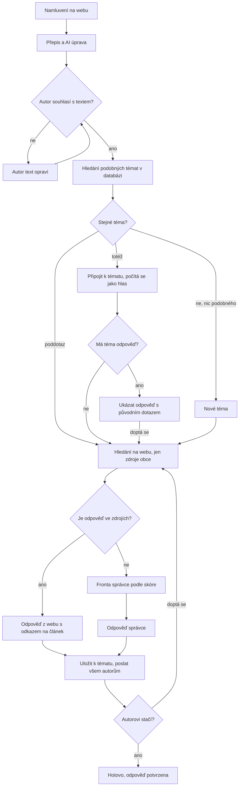
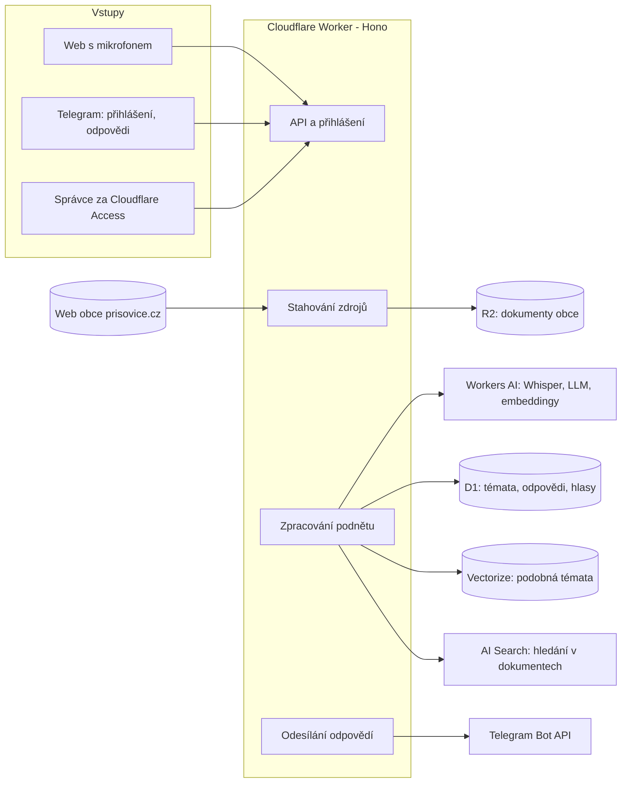

# PRD: Příšovické ucho

24. 10. 2026 · verze 0.8 (návrh k revizi)

> Export z Claude Docs. Živá verze, ve které se PRD dál upravuje: https://claude.ai/artifact/1uqzdxoYxj8jR45McMdo3Z. Diagramy jsou tady přepsané do Mermaid.

## Shrnutí

Lidé namluví návrh, dotaz nebo komentář do mikrofonu a AI z něj udělá srozumitelný vzkaz ve spisovné češtině. Odpověď se nejdřív hledá v už existujících tématech a na webu obce Příšovice. Zastupitelé odpovídají jen tam, kde zdroj chybí. Aplikace se jmenuje Příšovické ucho. Vstupem bude grafika ucha na webu nezavisli-prisovice.cz: po kliknutí se otevře rozhraní pro dotaz, přihlášení a odpovědi. Nejde o chatbota: AI s uživatelem nevede dialog.

**Cíle**

1. **Nízká bariéra:** podnět jde podat namluvením, bez psaní a bez složité registrace.
2. **Srozumitelné podněty:** každý uložený podnět je ve spisovné češtině a zařazený do oblasti a typu.
3. **Žádné duplicity:** stejné dotazy se sdruží do jednoho tématu s jednou odpovědí, podrobnější dotazy se k němu přidají jako poddotazy.
4. **Odpovědi z ověřených zdrojů:** automatická odpověď vychází výhradně z obsahu webu prisovice.cz a odkazuje na konkrétní článek. Jinak dotaz převezme správce.
5. **Priorita podle lidí:** hlasování palcem nahoru a dolů určuje, co správce vyřizuje nejdřív.
6. **Uzavřená smyčka:** autoři dostanou odpověď přes Telegram (preferovaný kanál), e-mail, SMS nebo WhatsApp.

**Jak číst tento návrh:** místa označená **Předpoklad** jsou můj odhad, ne vaše zadání. Potvrďte je, nebo opravte. Rozhodnutí, která potřebuji od vás, jsou v sekci Otevřené otázky.

**Pojmy:** podnět je jeden vzkaz jednoho člověka (návrh, dotaz, stížnost, pochvala). Téma sdružuje podněty se stejným obsahem a má hlavní dotaz, poddotazy a odpovědi. Hlasuje se o tématech.

**Změny proti předchozím verzím** jsou v sekci Historie verzí na konci dokumentu.

## Problém a kontext

Podněty dnes přicházejí roztroštěně, nečlánkově a bez zpětné vazby. Aplikace má řešit tři konkrétní potíže:

- **Psaní je bariéra.** Lidé raději řeknou, co si myslí. Mluvené slovo je ale nesouvislé a automatický přepis některá slova zkomolí.
- **Stejné otázky se opakují.** Odpověď často už je na webu obce, jen ji lidé nenajdou. Podobné dotazy nikdo neslčuje a zastupitelé na ně odpovídají znovu.
- **Podněty nejsou seřazené.** Není vidět, co trápí nejvíc lidí.
- **Autor se nedozví výsledek.** Chybí spolehlivý kanál, kterým by správce odpověděl přímo autorovi.

**Provozovatel:** uskupení Nezávislí Příšovice, které má 9 z 15 zastupitelů obce (potvrzeno 24. 10. 2026). Aplikace bude součástí jeho webu nezavisli-prisovice.cz a není úředním kanálem obce. Uživatelé jsou hlavně občané obce (**Předpoklad**). Zdrojem pravdy pro odpovědi jsou oficiální stránky obce [prisovice.cz](https://www.prisovice.cz), celý jejich obsah včetně zveřejněných dokumentů (potvrzeno 24. 10. 2026). Informace o aktuálních a budoucích projektech doplní web nezavisli-prisovice.cz (Předpoklad).

Hotový produkt, který by uměl celý tok, na GitHubu neexistuje. Aplikace se postaví na Cloudflare a převezme vzory z existujících projektů (viz Zdroje).

## Uživatelé a role

Aplikace má šest rolí. Každá vyšší role umí vše, co nižší.

| Role | Kdo to je | Co může |
| --- | --- | --- |
| Návštěvník | Kdokoli bez přihlášení | Číst všechna témata, poddotazy a odpovědi (potvrzeno 24. 10. 2026), začít nahrávat |
| Ověřený uživatel | Člověk s ověřeným kontaktem: Telegram, e-mail, SMS nebo WhatsApp | Od 15 let: podat podnět, doptat se, sledovat své podněty, dostávat odpovědi (**Předpoklad**: i lidé bez trvalého pobytu v Příšovicích) |
| Ověřený občan | Ověřený uživatel s ověřeným trvalým pobytem v Příšovicích | Navíc hlasovat palcem nahoru a dolů (potvrzeno 24. 10. 2026). V MVP se pobyt neověřuje a hlasuje každý přihlášený. |
| Správce oblasti | Zastupitel nebo člen týmu odpovědný za jednu nebo více oblastí (**Předpoklad**) | Vyřizovat témata své oblasti, odpovídat, měnit stav, slučovat duplicity |
| Moderátor | Může být totéž co správce | Skrýt nevhodný podnět, zablokovat uživatele |
| Administrátor | Tým Nezávislí Příšovice | Vše výše, navíc správa oblastí, správců, slovníku pro přepis, ověřování občanů a nastavení |

## Rozsah

MVP je prezentační verze: celý tok od namluvení po odpověď, jeden kanál (Telegram) a pozvaní testeři. Vše ostatní přijde až před ostrým spuštěním nebo později.

**V MVP**

- Grafika ucha na webu nezavisli-prisovice.cz. Po kliknutí se otevře rozhraní s mikrofonem, záložním textovým polem, přihlášením a odpověďmi.
- Přihlášení a odpovědi přes Telegram, od 15 let.
- Přepis řeči, AI úprava do spisovné češtiny a potvrzení textu autorem.
- Hledání podobných témat: připojit se, poddotaz, nebo nové téma.
- Odpověď z webu prisovice.cz s odkazem na zdroj. Autor potvrdí, že mu stačí, nebo se doptá. Web se zaindexuje jednou, aktualizace se spouští ručně.
- Bez odpovědi ze zdroje převezme dotaz správce.
- Veřejný seznam témat a odpovědí bez přihlášení, hlasování palcem pro přihlášené.
- Jednoduchá administrace: fronta podle skóre a odpověď. U každé odpovědi upozornění, že nejde o úřední vyjádření obce.

**Před ostrým spuštěním**

- E-mail jako druhý kanál.
- Souhlas se zpracováním (GDPR), zakrytí osobních údajů, moderace, smazání účtu.
- Ověření trvalého pobytu pro hlasování.
- Pravidelná aktualizace indexu webu a kontrola změněných zdrojů.
- Více správců podle oblastí, slučování a rozdělení témat.
- Slovník místních názvů pro přepis.

**Později**

- Automatické ověření pobytu přes elektronickou identitu (Identita občana nebo Bank iD).
- AI návrh témat ke sloučení pro správce.
- Hlasová zpráva přímo Telegram botovi, aplikace uvnitř Telegramu (Mini App).
- Správce odpovídá přímo z Telegramu.
- SMS a WhatsApp jako další kanály.
- Šablony odpovědí, statistiky a export.

**Mimo rozsah**

- Konverzační chatbot a hlasové odpovědi (převod textu na řeč).
- Odpovědi z jiných zdrojů než z obsahu webu prisovice.cz, například z obecných znalostí AI.
- Jiné jazyky než čeština (**Předpoklad**).
- Nativní mobilní aplikace pro Android a iOS, stačí web.

## Uživatelské scénáře

Po potvrzení textu se nejdřív hledá stejné téma v databázi, pak odpověď na webu obce. Správce dostane jen dotazy, na které neodpovědělo ani jedno.

Když systém najde podobné téma, rozhoduje autor: je to totéž, je to poddotaz, nebo jiné téma. U každé odpovědi, ať existující, z webu, nebo od správce, autor potvrdí, že mu stačí, nebo se doptá. Doplňující dotaz projde stejnou cestou jako poddotaz.

### Uživatelské příběhy

| Role | Chce | Proč |
| --- | --- | --- |
| Ověřený uživatel | Namluvit podnět na mobilu bez psaní | Psaní je zdlouhavé a odrazuje |
| Ověřený uživatel | Před odesláním vidět a opravit upravený text | Mít jistotu, že AI nezměnila smysl |
| Ověřený uživatel | Hned vidět, jestli se na tototéž už někdo ptal, i s odpovědí | Nemusí čekat na úřad |
| Ověřený uživatel | Doptat se, když existující odpověď nestačí | Dostat odpověď přesně na svou situaci |
| Ověřený uživatel | Odpověď s odkazem na článek obce | Ověřit si informaci u zdroje |
| Ověřený uživatel | Dostat odpověď do Telegramu | Nemusí hlídat web ani e-mail |
| Ověřený uživatel | Podpořit cizí téma palcem nahoru | Ukázat, že je téma důležité pro víc lidí |
| Ověřený uživatel | Vidět stav svých podnětů | Vědět, jestli se něco děje |
| Správce oblasti | Dostávat jen dotazy, na které web obce neodpovídá | Neodpovídat pořád na totéž |
| Správce oblasti | Frontu svých témat seřazenou podle skóre | Vyřizovat nejdřív to, co trápí nejvíc lidí |
| Správce oblasti | Sloučit témata nebo přesunout poddotaz | Opravit chybné zařazení |
| Administrátor | Spravovat oblasti a slovník pro přepis | Zpřesnit zařazení a přepis místních názvů |

## Funkční požadavky

Návrh má 68 požadavků v sedmi oblastech, 37 z nich je v MVP. Prioritu můžete přepnout ve sloupci Priorita.

### Nahrání podnětu

| ID | Požadavek | Priorita |
| --- | --- | --- |
| F-09 | Vstupem je grafika ucha na webu nezavisli-prisovice.cz. Kliknutí otevře rozhraní aplikace, aniž by člověk opustil web. Aplikace jde do webu vložit jedním skriptem nebo odkazem, aby úprava webu byla minimální. | MVP |
| F-01 | Tlačítko mikrofonu spustí a ukončí nahrávání. Ukazuje uplynulý čas a úroveň hlasitosti. | MVP |
| F-02 | Nahrávka trvá nejvýš 3 minuty, 30 s před koncem přijde upozornění (**Předpoklad**). | MVP |
| F-03 | Autor si nahrávku může přehrát, zahodit a nahrát znovu. | Později |
| F-04 | Záložní textové pole místo mikrofonu. | MVP |
| F-05 | Funguje v aktuálním Chrome na Androidu, Safari na iOS a v prohlížečích na počítači. | MVP |
| F-06 | Nahrávat jde i bez přihlášení. Přihlášení se vyžádá až při odeslání a nahrávka se neztratí. | Později |
| F-07 | Hlasová zpráva poslaná přímo Telegram botovi se zpracuje stejně jako nahrávka z webu. | Později |
| F-08 | Text se zobrazuje živě už během mluvení. | Zvážit |

### Přepis a AI úprava

| ID | Požadavek | Priorita |
| --- | --- | --- |
| F-10 | Řeč se přepíše do textu s jazykem pevně nastaveným na češtinu. | MVP |
| F-11 | Administrátor spravuje slovník místních názvů, institucí a zkratek, který zpřesní přepis. | Později |
| F-12 | AI přepíše text do spisovné češtiny a srozumitelného vzkazu. Nesmí přidat nic, co autor neřekl. | MVP |
| F-13 | AI navrhne název podnětu (nejvýš 80 znaků), oblast a typ: návrh, stížnost, dotaz, pochvala. | MVP |
| F-14 | Autor vidí upravený text, může ho opravit a odeslání potvrdí. Bez potvrzení se podnět neuloží. | MVP |
| F-15 | Uloží se surový přepis i upravený text. Správce vidí obojí. | MVP |
| F-16 | AI označí podezřelý obsah (spam, vulgarity, osobní údaje jiných lidí) k moderaci před zveřejněním. | Později |
| F-17 | AI ve veřejné verzi zakryje osobní údaje, například jména, telefony a adresy. Témata jsou veřejná, proto je to nutné před ostrým spuštěním. | Později |

### Přihlášení a kontakt

| ID | Požadavek | Priorita |
| --- | --- | --- |
| F-19 | Podávat podněty a hlasovat smí lidé od 15 let. V MVP to uživatel potvrdí zaškrtnutím při přihlášení (hranice pro hlasování je Předpoklad). | MVP |
| F-20 | Přihlášení přes Telegram: odkaz otevře bota a ten spáruje účet. Bot tím zároveň získá povolení posílat uživateli zprávy. | MVP |
| F-21 | Přihlášení e-mailem jednorázovým kódem (6 číslic, platnost 10 minut). | Později |
| F-22 | Přihlášení kódem v SMS. | Později |
| F-23 | Přihlášení a odpovědi přes WhatsApp. | Zvážit |
| F-24 | Uživatel si zvolí preferovaný kanál pro odpovědi a může mít víc ověřených kanálů. | Později |
| F-25 | Přihlášení vydrží 30 dní na stejném zařízení (**Předpoklad**). | MVP |
| F-26 | Uživatel může smazat účet i své podněty. | Později |
| F-27 | Hlasovat smí jen ověřený občan s trvalým pobytem v Příšovicích. Bez ověření jde témata číst a podněty podávat, ne hlasovat. | Později |
| F-28 | Ruční ověření pobytu: uživatel uvede adresu v Příšovicích a tým ji ručně potvrdí. Úřad ověření dělat nebude, provozovatelem není obec (**Předpoklad**, viz Otevřené otázky). | Později |
| F-29 | Automatické ověření trvalého pobytu přes elektronickou identitu (Identita občana nebo Bank iD). | Později |

### Témata a slučování dotazů

| ID | Požadavek | Priorita |
| --- | --- | --- |
| F-30 | Oblasti spravuje administrátor podle aktuálních a budoucích projektů uvedených na nezavisli-prisovice.cz, plus oblast Ostatní. Po skončení projektu se oblast archivuje a její témata zůstanou dohledatelná. | MVP |
| F-31 | Každá oblast má přiřazeného správce, kterému se její témata směrují. | Později |
| F-32 | Správce může zařazení navržené AI ručně změnit. | Později |
| F-33 | Podobné dotazy se sdružují do jednoho tématu. Téma má hlavní dotaz, poddotazy a odpovědi. | MVP |
| F-34 | Po potvrzení textu systém vyhledá podobná témata podle významu, ne jen podle slov. Autorovi ukáže nejvýš 3 nejbližší i s odpovědí, pokud existuje. | MVP |
| F-35 | Autor zvolí: „Je to totéž“ (připojí se k tématu), „Ptám se na víc“ (přidá poddotaz), nebo „Je to jiné téma“ (založí nové). | MVP |
| F-36 | Připojený autor se počítá jako podpora tématu a dostane každou novou odpověď k tématu. | MVP |
| F-37 | Když téma už má odpověď, autor ji hned uvidí spolu s původním dotazem. Když mu nestačí, doptá se a doplňující dotaz se uloží jako poddotaz. | MVP |
| F-38 | Správce může témata sloučit, rozdělit nebo poddotaz přesunout. Hlasy a připojení autoři se převedou. | Později |
| F-39 | Systém správci navrhne podobná témata ke kontrole a sloučení. | Později |

### Odpovědi ze zdrojů obce

| ID | Požadavek | Priorita |
| --- | --- | --- |
| F-70 | Zdrojem pravdy je celý obsah webu prisovice.cz: stránky, aktuality i zveřejněné dokumenty (PDF). Úřední deska na prisovice.e-obec.cz se nesleduje, je zastaralá. Informace o aktuálních a budoucích projektech doplní web nezavisli-prisovice.cz (Předpoklad). | MVP |
| F-71 | Při spuštění systém jednou projde celý web včetně PDF a zaindexuje ho. Pak pravidelně stahuje jen nové a změněné stránky a dokumenty podle mapy webu a data změny. Interval nastaví administrátor (výchozí denně, lze týdně) a aktualizaci může spustit i ručně. V MVP stačí jednorázové zaindexování a ruční aktualizace. | MVP |
| F-72 | Na nový dotaz nebo poddotaz bez odpovědi systém nejdřív hledá odpověď ve zdrojích obce. Návrhy a stížnosti jdou vždy ke správci (**Předpoklad**). | MVP |
| F-73 | AI smí odpovědět jen informacemi z nalezených dokumentů. Obecné znalosti modelu ani domněnky se nepoužijí. | MVP |
| F-74 | Každá odpověď uvádí odkaz na zdrojový článek nebo dokument, jeho název a datum zveřejnění. | MVP |
| F-75 | Odpověď se ověří proti zdroji: každé tvrzení musí mít oporu v citovaném úryvku, jinak se odpověď nepoužije. | MVP |
| F-76 | Když zdroje odpověď neobsahují nebo jistota nestačí, dotaz přejde do fronty správce s poznámkou, co se hledalo. | MVP |
| F-77 | Odpověď nalezená na webu se uloží do databáze odpovědí k tématu a použije se pro další podobné dotazy. | MVP |
| F-78 | Když se zdrojový dokument změní nebo zmizí, navázané odpovědi se označí ke kontrole správcem. | Později |
| F-79 | Automatická odpověď se autorovi ukáže hned, bez schválení správcem (potvrzeno 24. 10. 2026). Je označená „Odpověď z webu obce“ a správce ji může dodatečně opravit nebo stáhnout. | MVP |
| F-80 | U zdroje staršího než 2 roky odpověď upozorní, že informace nemusí být aktuální. | Zvážit |
| F-81 | U každé odpovědi autor zvolí „Odpověď mi stačí“, nebo „Chci se doptat“. Doptání se uloží jako poddotaz a projde stejnou cestou. | MVP |
| F-82 | Před zobrazením odpovědi systém cíleně ověří, že citovaná stránka nebo dokument na webu stále je a nezměnil se. | Později |
| F-83 | Odpovědi, které autoři potvrdili jako dostačující, se dalším tazatelům nabízejí přednostně. | Později |

### Hlasování a pořadí

| ID | Požadavek | Priorita |
| --- | --- | --- |
| F-40 | Přihlášený uživatel dá tématu palec nahoru nebo dolů. Jeden hlas na téma, jde změnit i zrušit. Po zavedení ověření pobytu (F-27) smí hlasovat jen ověřený občan. | MVP |
| F-41 | Autor má u tématu, ke kterému patří jeho podnět, automaticky palec nahoru a nemůže hlasovat proti (**Předpoklad**). | Později |
| F-42 | Pořadí určuje skóre, které zohlední poměr i počet hlasů a počet připojených autorů, ne jen rozdíl hlasů. | MVP |
| F-43 | U tématu je vidět počet hlasů nahoru a dolů zvlášť. | MVP |
| F-44 | Veřejný seznam témat a odpovědí je dostupný bez přihlášení (potvrzeno 24. 10. 2026). Jde filtrovat podle oblasti, typu a stavu a řadit podle skóre nebo data. | MVP |

### Administrace a odpovědi

| ID | Požadavek | Priorita |
| --- | --- | --- |
| F-50 | Fronta témat bez odpovědi ze zdroje, seřazená podle skóre, s filtrem podle oblasti, typu a stavu. | MVP |
| F-51 | Detail tématu: hlavní dotaz, poddotazy, upravené texty i surové přepisy, nahrávky, hlasy, odpovědi se zdroji a historie změn. | MVP |
| F-52 | Stavy tématu: Nové, Zodpovězeno z webu, Čeká na správce, V řešení, Zodpovězeno, Vyřešeno, Zamítnuto, Sloučeno. | MVP |
| F-53 | Odpověď se pošle všem autorům tématu, každému jeho preferovaným kanálem. Když selže, použije se jiný ověřený kanál. | MVP |
| F-54 | Správce vidí, jestli byla odpověď doručena. | Později |
| F-55 | Autor dostane potvrzení, že podnět byl přijat. | Později |
| F-56 | Autor dostane upozornění při změně stavu tématu. | Později |
| F-57 | Odpověď se zobrazí i veřejně u tématu. | Zvážit |
| F-58 | Šablony odpovědí a interní poznámky správců. | Později |
| F-59 | Správce odpovídá přímo z Telegramu, z vlákna v administrátorské skupině. | Později |
| F-60 | Export podnětů do CSV a základní statistiky po oblastech. | Později |

## Nefunkční požadavky

Všechny cílové hodnoty v tabulce jsou **Předpoklad**. Upravte je podle očekávaného objemu a rozpočtu.

Pro prezentační verzi (MVP) platí jen rychlost a věrohodnost odpovědí. GDPR, přístupnost, dostupnost a audit se řeší před ostrým spuštěním.

| Oblast | Požadavek |
| --- | --- |
| Věrohodnost odpovědí | Žádná automatická odpověď bez opory ve zdroji. Každé tvrzení má citovaný úryvek a odkaz na dokument obce. |
| Aktuálnost zdrojů | Změna na webu obce se v indexu projeví nejpozději do jednoho intervalu aktualizace: 24 hodin při výchozím nastavení, 7 dní při týdenním. Citovaný zdroj se před zobrazením odpovědi cíleně ověří. |
| Rychlost | Stránka se na mobilu se sítí 4G načte do 2 s. Upravený text 1minutové nahrávky uvidí autor do 20 s, podobná témata a odpověď z webu do dalších 10 s. |
| Objem | Do 1 000 podnětů, 10 000 hlasů a 5 000 zdrojových dokumentů bez změny architektury. |
| Dostupnost | 99,5 % měsíčně. Při výpadku AI se nahrávka uloží do fronty a zpracuje později, autor dostane zprávu. |
| Bezpečnost | Ochrana proti robotům (Cloudflare Turnstile), nejvýš 5 podnětů za hodinu na uživatele, administrace za Cloudflare Access, klíče jen v šifrovaných proměnných. |
| GDPR | Souhlas se zpracováním včetně AI, nahrávky se mažou po 30 dnech, export a smazání osobních údajů na žádost, data uložená v EU. U ověření pobytu se ukládá jen příznak, způsob a datum ověření, ne celá adresa. Veřejně se ukazuje jen text tématu bez jména autora a osobní údaje se zakrývají (**Předpoklad**). |
| Přístupnost | WCAG 2.1 úroveň AA, ovládání klávesnicí, textová alternativa k mikrofonu. |
| Jazyk | Rozhraní i zpracování jen v češtině. |
| Náklady | Provoz MVP v řádu jednotek až desítek USD měsíčně: Workers Paid za 5 USD plus AI, vyhledávání a stahování webu podle objemu. SMS a WhatsApp se platí za zprávu. |
| Provoz | Logování chyb, upozornění při výpadku nebo selhání stahování webu, zálohy databáze s možností obnovy za posledních 30 dní. |
| Auditovatelnost | Každá změna stavu, sloučení a odpověď má záznam kdo a kdy. U automatické odpovědi se uloží i použité úryvky a verze zdroje. |

Kde přesně běží výpočet AI na Cloudflare (EU, nebo mimo), je potřeba ověřit kvůli GDPR.

## Datový model

Aplikace potřebuje dvanáct entit. Jádrem je téma, ke kterému patří podněty, hlasy a odpovědi se zdroji. Podrobné SQL schéma z rešerše je potřeba podle toho upravit.

| Entita | Hlavní údaje | Pravidla |
| --- | --- | --- |
| Uživatel | Jméno pro zobrazení, datum registrace, role, ověřený občan ano/ne se způsobem a datem ověření | Jeden člověk = jeden účet, i když má víc kanálů |
| Kontakt | Kanál (Telegram, e-mail, SMS, WhatsApp), adresa, datum ověření, preferovaný ano/ne | Adresa je v rámci kanálu unikátní |
| Oblast | Název, navázaný projekt obce, aktivní ano/ne, přiřazený správce | Po skončení projektu se archivuje i s tématy |
| Téma | Hlavní dotaz ve spisovné češtině, oblast, typ, stav, skóre | Jedno téma = jeden obsah. Sloučené téma odkazuje na hlavní. |
| Podnět | Autor, téma, surový přepis, upravený text, vztah k tématu (zakladatel, totéž, poddotaz, doplnění), odkaz na nahrávku | Patří právě k jednomu tématu |
| Hlas | Téma, uživatel, hodnota +1 nebo −1, datum | Nejvýš jeden hlas od uživatele na téma |
| Odpověď | Téma nebo poddotaz, text, původ (web obce, správce), stav (platná, ke kontrole, stažená), kdo ji schválil, potvrzení autorů (stačí, doptání) | Odpověď z webu má aspoň jednu citaci |
| Zdrojový dokument | URL, název, web (prisovice.cz, nezavisli-prisovice.cz), typ (stránka, aktualita, PDF), datum zveřejnění a změny, otisk obsahu, datum stažení | Změna otisku spustí kontrolu navázaných odpovědí |
| Citace | Odpověď, zdrojový dokument, citovaný úryvek | Ke každému tvrzení odpovědi |
| Odeslání | Odpověď, příjemce, kanál, stav doručení | Jedna odpověď jde všem autorům tématu |
| Historie | Téma, kdo, co změnil, kdy | Jen přidávání, nikdy úprava |
| Slovník | Výraz, správný zápis, poznámka | Použije se při přepisu i AI úpravě |

Nahrávky se ukládají mimo databázi (Cloudflare R2) a mažou se po 30 dnech (**Předpoklad**).

## Technické řešení

Aplikace poběží celá na Cloudflare v jednom Workeru. Mimo Cloudflare je jen web obce jako zdroj odpovědí a služby pro doručení odpovědí.

Hosting zatím není rozhodnutý (Cloudflare, nebo Zerops + Mistral). Diagram ukazuje variantu s Cloudflare.

Nahrávka jde z webu do Workeru, ten ji přepíše a upraví přes Workers AI. Podobná témata hledá ve Vectorize, odpověď v dokumentech obce přes AI Search. Web obce se jednou stáhne celý do R2 a pak se denně doplňují jen změny.

| Vrstva | Volba | Poznámka |
| --- | --- | --- |
| Běh aplikace | Cloudflare Workers + Hono | Web i API v jednom projektu |
| Databáze | Cloudflare D1 | Zálohy s obnovou za 30 dní |
| Nahrávky a dokumenty obce | Cloudflare R2 | Nahrávky se mažou po 30 dnech, dokumenty se drží aktuální |
| Přepis řeči | Workers AI, model `whisper-large-v3-turbo` | Alternativa Deepgram Nova-3, vybrat po testu na českých nahrávkách |
| AI úprava a zařazení | Jazykový model na Workers AI přes AI Gateway | Model vybrat podle kvality češtiny |
| Podobná témata | Vectorize + vícejazyčné embeddingy (`bge-m3`) | Index nad hlavními dotazy a poddotazy témat |
| Stahování webu obce | Browser Rendering `/crawl` (beta od 10. 3. 2026). Jednou celý web, pak jen změny (výchozí denně, lze týdně). WordPress REST API jen jako záloha | Web obce zřejmě běží na WordPressu (dokumenty leží v `/wp-content/uploads/`). Vestavěné procházení webu v AI Search funguje jen pro doménu ve vlastním Cloudflare účtu. |
| Vyhledání odpovědi | AI Search nad R2 s dokumenty obce | Vrací úryvky se zdrojem. Odpověď skládá jazykový model jen z nich a druhý krok ji ověří proti citacím. |
| Asynchronní zpracování | Cloudflare Workflows nebo Queues | Opakování při výpadku AI |
| Přihlášení | Better Auth + ověření Telegramu | E-mailový kód v MVP, SMS později |
| Ochrana | Turnstile, Rate Limiting, Cloudflare Access | Access chrání administraci |
| E-mail | Cloudflare Email Service nebo Resend | Ověřit, jestli je Email Service mimo betu |

### Procházení webu: index místo hledání až při dotazu

Celý web prisovice.cz včetně PDF se zaindexuje jednou. Pak se pravidelně doplňují jen nové a změněné stránky a dokumenty, ne všechna PDF znovu. Výchozí interval je denně, administrátor ho může změnit na týdně (rozhodnuto 24. 10. 2026). Při dotazu se cíleně ověří jen citovaný zdroj.

| Kritérium | Index a denní změny (doporučeno) | Cílené hledání až při dotazu |
| --- | --- | --- |
| Obsah PDF | Prohledává se, je v indexu | Neprohledává se: vyhledávání WordPressu PDF nevidí |
| Jinak formulovaný dotaz | Najde podle významu | Jen podle přesných slov, skloňování v češtině hodně odpovědí mine |
| Rychlost odpovědi | Rychlá, index je připravený | Pomalá, stránky a PDF se stahují a čtou u každého dotazu |
| Aktuálnost | Do jednoho intervalu aktualizace, citovaný zdroj se ověří při zobrazení | Vždy aktuální |
| Práce správce | Méně dotazů skončí jako nenalezené | Víc dotazů propadne ke správci |
| Údržba | Pravidelná úloha a úložiště dokumentů | Bez indexu |

Obecní web je malý, takže první procházení i denní aktualizace budou levné. Kolik stránek a PDF web skutečně má, ukáže až první procházení.

### Co MVP potřebuje k provozu

Prezentační verze poběží celá na jednom Cloudflare účtu. Odhad provozu je do 10 USD měsíčně, přesná čísla ukáže první měsíc.

| Položka | Pro MVP | Cena |
| --- | --- | --- |
| Hosting a databáze | Cloudflare účet s plánem Workers Paid: Workers, D1, R2, Vectorize, AI Search, Workers AI, Browser Rendering | 5 USD měsíčně, AI a vyhledávání podle objemu |
| Adresa aplikace | Bezplatná adresa `*.workers.dev`, vlastní doména až pro ostrý provoz | Zdarma |
| Telegram | Bot založený přes @BotFather | Zdarma |
| Data z webu obce | Jednorázově stažený web prisovice.cz, stránky a PDF v R2 | V ceně R2 |
| Kód a nasazení | Repozitář na GitHubu (už existuje), nasazení příkazem `wrangler deploy` | Zdarma |

K nasazení přímo z této session je potřeba Cloudflare API token uložený jako tajná proměnná prostředí. Jinak nasazení spustíte sami jedním příkazem.

## Metriky úspěchu

Úspěch poznáme podle toho, jestli lidé podněty dokončí, jestli AI text sedí a jestli autoři dostanou odpověď. Cílové hodnoty jsou **Předpoklad** pro první 3 měsíce provozu.

| Metrika | Jak se měří | Cíl |
| --- | --- | --- |
| Odpovědi bez opory | Automatické odpovědi, které správce označil jako nepodložené zdrojem | 0 |
| Zodpovězeno z webu | Nová témata typu dotaz zodpovězená automaticky ze zdrojů / všechna nová témata typu dotaz | Sledovat, cíl po pilotu |
| Zachycené duplicity | Podněty připojené k existujícímu tématu jako totéž nebo poddotaz / všechny podněty | Sledovat, cíl po pilotu |
| Dokončené podněty | Odeslané podněty / spuštěné nahrávky | ≥ 60 % |
| Kvalita AI textu | Podněty potvrzené bez úprav autora / všechny potvrzené | ≥ 70 % |
| Přesnost zařazení | Témata, kde správce neměnil oblast / všechna | ≥ 85 % |
| Podíl zodpovězených | Témata s odpovědí / všechna starší 14 dní | ≥ 80 % |
| Čas do odpovědi správce | Medián od podání po první odpověď u témat bez odpovědi z webu | ≤ 5 pracovních dní |
| Doručitelnost | Doručené odpovědi / odeslané | ≥ 98 % |
| Zapojení | Průměrný počet hlasů a připojených autorů na téma | Sledovat, cíl po pilotu |
| Odpovědi, které stačily | Odpovědi potvrzené autorem jako dostačující / všechny zobrazené odpovědi | Sledovat, cíl po pilotu |

## Fáze a milníky

Vývoj má čtyři fáze. Už MVP pokryje celý tok od namluvení po odpověď, další fáze přidávají kvalitu a kanály.

| Fáze | Obsah | Hotovo, když |
| --- | --- | --- |
| 1. MVP | Web s mikrofonem, přepis a AI úprava, slučování do témat, odpovědi z webu, přihlášení přes Telegram, hlasování a fronta | prezentace |
| 2. Ostrý provoz | E-mail, GDPR a moderace, zakrytí údajů, denní index webu, ověření pobytu, správci oblastí | ověřeno v pilotu |
| 3. Telegram | Hlasovky botovi, Mini App, odpovědi ze skupiny | hlasovky fungují |
| 4. Další kanály | SMS, WhatsApp, ověření přes eID, AI návrh sloučení, živý přepis | podle poptávky |

Termíny doplním, až bude jasný cílový termín MVP a velikost pilotu (viz Otevřené otázky). Pořadí fází 2 a 3 jde prohodit, pokud jsou hlasovky v Telegramu důležitější než nástroje pro správce.

## Rizika

Největší riziko je, že AI odpoví jménem obce něčím, co ve zdroji není. Proto každá automatická odpověď stojí na citaci a bez ní jde dotaz ke správci.

| Riziko | Dopad | Zmírnění |
| --- | --- | --- |
| AI odpoví něčím, co ve zdroji není | Občan dostane chybnou informaci jménem zastupitelů | Odpověď jen z nalezených úryvků, ověření každého tvrzení proti citaci, jinak předání správci, označení „Odpověď z webu obce“ |
| Zastaralá informace na webu | Odpověď platí pro minulý stav | Datum zdroje u každé odpovědi, pravidelná aktualizace indexu, kontrola odpovědí po změně dokumentu |
| Chybné sloučení různých dotazů | Autor dostane odpověď na jinou otázku | O shodě rozhoduje autor, správce může téma rozdělit nebo poddotaz přesunout |
| Autoři „jiné téma“ zneužívají | Duplicity se vrátí | Správce témata dodatečně slučuje, později s návrhy od AI |
| Web obce blokuje stahování | Index nebude aktuální | Kontakt na správce webu je k dispozici: povolení crawleru, případně WordPress REST API |
| AI změní smysl vzkazu | Správce řeší něco jiného, než autor chtěl | Potvrzení autorem, uložení surového přepisu, pokyn AI nepřidávat informace |
| Špatný přepis místních názvů | Nesrozumitelné nebo chybně zařazené podněty | Slovník domény, test modelu na 20 až 30 reálných nahrávkách před spuštěním |
| Manipulace s hlasováním | Pořadí neodpovídá skutečnému zájmu | Hlasuje jen ověřený občan, jeden hlas na téma, rate-limit, Turnstile |
| Spam a vulgarity | Veřejný seznam ztratí důvěryhodnost | AI označí podezřelé podněty, moderace před zveřejněním |
| GDPR a osobní údaje | Pokuta, ztráta důvěry | Souhlas, krátká retence nahrávek, data v EU, dalším tazatelům jen text dotazu bez jména |
| Telegram bot nemůže napsat první | Odpověď se nedoručí | Povolení zpráv získat už při přihlášení, záložní kanál |
| Ceny WhatsAppu a SMS | Nečekané náklady | Spustit až po ověření poptávky, měsíční limit výdajů |
| Palec dolů odrazuje autory | Méně podnětů | Zvážit jen kladnou podporu, nebo palec dolů bez zobrazení jména |
| Správci nestíhají odpovídat | Lidé přestanou podněty posílat | Odpovědi z webu, slučování do témat, šablony odpovědí, cíl na čas odpovědi |
| Naskenovaná PDF bez textu | Odpověď v nich se nenajde | Rozpoznání textu (OCR) při zaindexování, seznam PDF bez textu po prvním procházení |
| Ověřování občanů zatíží úřad | Pomalé schvalování, lidé nebudou hlasovat | Jednorázové kódy z úřadu, později automatické ověření přes elektronickou identitu |
| Veřejné texty obsahují osobní údaje | Zveřejnění údajů sousedů nebo autora | AI zakryje osobní údaje před zveřejněním, podezřelé texty jdou nejdřív k moderaci |
| Hosting není v katalogu cloud computingu | Týká se jen provozu obcí, při provozu uskupením neplatí | Před ostrým provozem ověřit zápis v katalogu DIA. Aplikaci stavět přenositelně (Node.js, PostgreSQL, S3, OpenAI-kompatibilní API), aby šla přesunout k zapsanému poskytovateli. |
| Aplikace působí jako úřední kanál obce | Zmátení občanů, stížnosti na obec | Jasně uvedený provozovatel a u každé odpovědi upozornění, že nejde o úřední vyjádření obce |
| Podpora témat na webu politického uskupení může prozradit politické názory | Zvláštní kategorie osobních údajů podle GDPR | Výslovný souhlas, hlasy veřejně jen v součtech, minimum ukládaných údajů |

## Otevřené otázky

Rozhodnuté otázky jsou zaškrtnuté. Pro start prezentační verze jsou potřeba odpovědi na prvních šest otevřených otázek, ostatní počkají na ostrý provoz.

- [x] **Provozovatel:** uskupení Nezávislí Příšovice (9 z 15 zastupitelů), aplikace bude součástí webu nezavisli-prisovice.cz (upřesněno 24. 10. 2026). To, že uživatelé jsou občané obce, je zatím **Předpoklad**.
- [x] **Schvalování automatických odpovědí:** odpověď z webu se autorovi ukáže hned a autor potvrdí, že mu stačí, nebo se doptá (potvrzeno 24. 10. 2026).
- [x] **Zdroje pravdy:** celý obsah webu prisovice.cz (potvrzeno 24. 10. 2026).
- [x] **Úřední deska:** nesleduje se, obsah na prisovice.e-obec.cz je zastaralý (rozhodnuto 24. 10. 2026).
- [x] **Procházení webu:** web se zaindexuje jednou celý, pak se sledují jen změny. Výchozí interval je denně, lze přepnout na týdně (rozhodnuto 24. 10. 2026).
- [x] **Přístup k webu:** web se stahuje bez spolupráce správce webu. Kontakt na správce je k dispozici, kdyby web stahování blokoval nebo bylo potřeba WordPress REST API (rozhodnuto 24. 10. 2026).
- [x] **Veřejnost:** témata, poddotazy a odpovědi vidí všichni bez přihlášení (rozhodnuto 24. 10. 2026).
- [x] **Kdo smí hlasovat:** jen občané Příšovic s ověřeným trvalým pobytem (rozhodnuto 24. 10. 2026).
- [x] **Způsob ověření pobytu:** v MVP se neřeší, přijde před ostrým spuštěním (rozhodnuto 24. 10. 2026).
- [x] **Věková hranice:** podněty smějí podávat lidé od 15 let (rozhodnuto 24. 10. 2026). Stejná hranice pro hlasování je zatím **Předpoklad**.
- [x] **Oblasti:** podle aktuálních a budoucích projektů na nezavisli-prisovice.cz (rozhodnuto 24. 10. 2026).
- [ ] **Hosting:** Cloudflare, nebo český či evropský hosting? Katalog cloud computingu se netýká, provozovatel není obec. Rozhodne hlavně to, na čem běží web nezavisli-prisovice.cz. Srovnání je v rešerši (viz Zdroje).
- [ ] **Správce osobních údajů:** kdo bude podle GDPR správcem? Sdružení nezávislých kandidátů není právnická osoba, takže spolek, nebo konkrétní člověk?
- [ ] **Hlasové modely a TTS:** zjištění z projektu Podcast Language Learning App (lessons-learned.md) zatím nemám k dispozici. A mají se odpovědi i přečíst nahlas? Zatím je to mimo rozsah.
- [ ] **Kanál v MVP:** stačí pro prezentaci jen Telegram? E-mail by přišel před ostrým spuštěním.
- [ ] **Hlasování v MVP:** bez ověření pobytu by hlasoval každý přihlášený. Je to pro prezentaci v pořádku?
- [ ] **Seznam projektů:** zdrojem je lokální složka webu WEB\_Prisovice, jen ke čtení. Cloudová session k ní nemá přístup, projekty načte lokální session na vašem počítači.
- [ ] **Zdroj pro projekty:** mají se odpovědi o projektech brát i z nezavisli-prisovice.cz, nebo jen z prisovice.cz?
- [ ] **Podněty od neobčanů:** smějí po ostrém spuštění podávat podněty i lidé bez trvalého pobytu v Příšovicích?
- [ ] **Ověření pobytu bez úřadu:** jak ověřit občany, když provozovatel není obec? Možnosti jsou ruční potvrzení týmem, nebo elektronická identita.
- [ ] **Jméno autora:** zobrazuje se u tématu, nebo je veřejně vidět jen text dotazu?
- [ ] **Palec dolů:** chcete ho opravdu, nebo jen kladnou podporu?
- [ ] **Interní podklady:** může obec doplnit vlastní dokumenty, které na webu nejsou, například odpovědi na časté dotazy?
- [ ] **Stáří zdrojů:** od jakého stáří má odpověď upozorňovat, že informace nemusí platit? Návrh je 2 roky.
- [ ] **Odpověď správce na webu:** má se odpověď, kterou napsal správce, následně zveřejnit i na webu obce, aby se stala zdrojem pro další dotazy?
- [ ] **Objem:** kolik podnětů a uživatelů měsíčně čekáte?
- [ ] **Rozpočet:** kolik může stát provoz měsíčně, včetně SMS a WhatsAppu?
- [ ] **Nahrávky:** uchovávat audio? Pokud ano, jak dlouho?
- [ ] **Termín a pilot:** kdy chcete MVP spustit a s jakou skupinou lidí ho otestovat?
- [ ] **Doména a vzhled:** na jaké adrese aplikace poběží a máte logo a barvy?

## Historie verzí

| Verze | Datum | Změny |
| --- | --- | --- |
| 0.8 | 1. 11. 2026 | Název Příšovické ucho (repozitář prisovicke-ucho); vstupem je grafika ucha na webu nezavisli-prisovice.cz (F-09); lokální zdroje jen ke čtení; otázka hlasových modelů a TTS |
| 0.7 | 24. 10. 2026 | Provozovatelem je uskupení Nezávislí Příšovice (9 z 15 zastupitelů), aplikace bude součástí webu nezavisli-prisovice.cz; katalog cloud computingu se netýká; upozornění, že odpovědi nejsou úředním vyjádřením obce; nová rizika a otázka správce osobních údajů |
| 0.6 | 24. 10. 2026 | MVP zeštíhleno na prezentační verzi (36 požadavků, jen Telegram), ověření pobytu a GDPR až před ostrým spuštěním, věková hranice 15 let, oblasti podle projektů na nezavisli-prisovice.cz, nároky na provoz |
| 0.5 | 24. 10. 2026 | Témata a odpovědi veřejné bez přihlášení, hlasují jen ověření občané Příšovic, oblasti podle aktivních projektů obce, zakrytí osobních údajů přesunuto do MVP |
| 0.4 | 24. 10. 2026 | Úřední deska na e-obci se nesleduje, interval aktualizace webu nastavitelný (výchozí denně, lze týdně), web se stahuje bez spolupráce správce webu |
| 0.3 | 24. 10. 2026 | Autor u každé odpovědi potvrdí, že stačí, nebo se doptá; zdrojem pravdy celý web prisovice.cz; web se zaindexuje jednou a pak se doplňují změny |
| 0.2 | 24. 10. 2026 | Slučování dotazů do témat při podání, odpovědi z webu obce s odkazem na zdroj, provozovatel obec Příšovice |
| 0.1 | 24. 10. 2026 | První návrh |

## Zdroje

Kompletní seznam zdrojů je v [rešerši hotových řešení](https://github.com/drbik/text-summarizer/blob/ccr-0bd17529-03aszn/docs/research-hlasove-podnety.md) z 17. 10. 2026. Tento PRD vychází hlavně z těchto:

| Zdroj | K čemu poslouží |
| --- | --- |
| [Oficiální web obce Příšovice](https://www.prisovice.cz) | Zdroj pravdy pro odpovědi |
| [Jednací řád zastupitelstva 2022–2026 (PDF na webu obce)](https://prisovice.cz/wp-content/uploads/2024/01/jednaci-rad-2022-2026.pdf) | Ukázka, že dokumenty obce jsou PDF ve WordPressu |
| [Úřední deska obce (e-obec)](https://prisovice.e-obec.cz/urednideska.php?soubor=378) | Nesleduje se, obsah je zastaralý (rozhodnuto 24. 10. 2026) |
| [Cloudflare: endpoint /crawl (changelog 10. 3. 2026)](https://developers.cloudflare.com/changelog/2026-03-10-br-crawl-endpoint) | Stahování webu obce do R2 |
| [Cloudflare: procházení webů službami Cloudflare](https://developers.cloudflare.com/fundamentals/reference/cloudflare-site-crawling/) | Omezení AI Search na doménu ve vlastním účtu |
| [Cloudflare: Voice Notes App](https://developers.cloudflare.com/workers-ai/tutorials/build-a-voice-notes-app-with-auto-transcription) | Postup mikrofon, přepis, AI úprava, databáze |
| [Cloudflare: Whisper pro delší nahrávky](https://developers.cloudflare.com/workers-ai/tutorials/build-a-workers-ai-whisper-with-chunking) | Dělení dlouhého audia |
| [almeidamarcell/marapulse](https://github.com/almeidamarcell/marapulse) | Hlasování, kategorie, stavy, administrace na Cloudflare |
| [idoZ-H/issuary](https://github.com/idoZ-H/issuary) | AI třídění vzkazů, slučování a odpověď autorovi |
| [miss82824352235/tg-pm-support-bot](https://github.com/miss82824352235/tg-pm-support-bot) | Odpovídání z vláken v Telegram skupině |
| [ruguevara/tg-feedback-bot](https://github.com/ruguevara/tg-feedback-bot) | Telegram bot pro příjem a vyřízení podnětů |
| [zpg6/better-auth-cloudflare](https://github.com/zpg6/better-auth-cloudflare) | Přihlášení e-mailem a SMS kódem |
| [Telegram Login Widget](https://core.telegram.org/widgets/login-legacy) | Přihlášení přes Telegram a povolení zpráv |
| [Deepgram: Nova-3 a čeština](https://deepgram.com/learn/deepgram-expands-nova-3-with-11-new-languages-across-europe-and-asia) | Alternativní model přepisu |
| [respond.io: ceník WhatsApp 2026](https://respond.io/blog/whatsapp-pricing-change-2026.md) | Náklady WhatsAppu od 1. 10. 2026 |
| [Identita občana: příručka pro poskytovatele služeb](https://info.identita.gov.cz/download/SeP_PriruckaKvalifikovanehoPoskytovatele.pdf) | Možné automatické ověření trvalého pobytu, neověřeno |
| [Bank iD: přehled pro poskytovatele služeb](https://developer.bankid.cz/docs/high_level_overview_sep) | Alternativa ověření adresy, neověřeno |

Web obce ani dokumentaci Cloudflare jsem z tohoto prostředí nemohl otevřít, přístup je blokovaný. Údaje o nich pocházejí z výsledků vyhledávání a před implementací je potřeba je ověřit.
